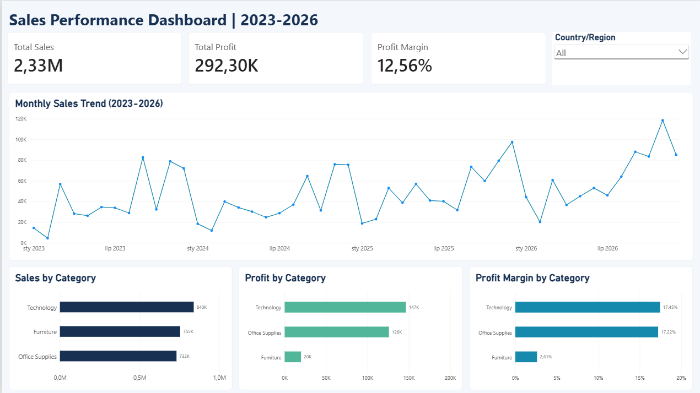
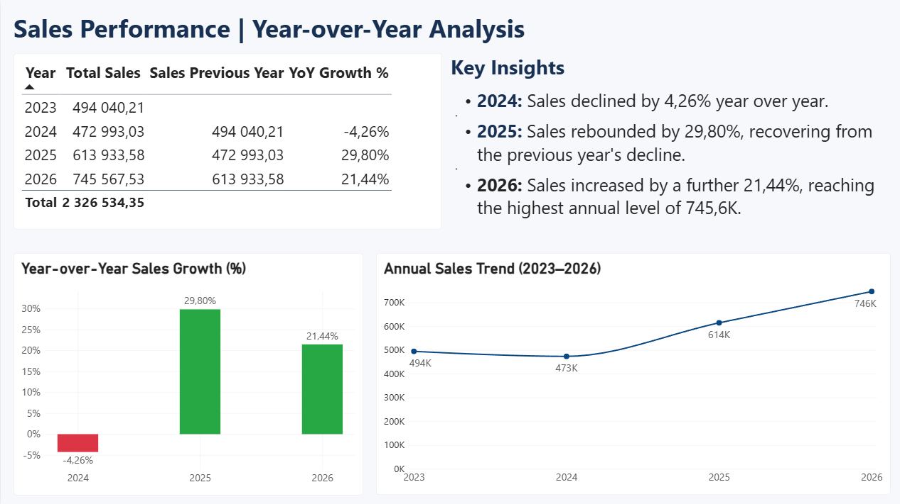

# Sales Performance Dashboard | Power BI

## Project Overview

This project presents an interactive Power BI dashboard designed to analyze sales performance, profitability, and year-over-year (YoY) growth between 2023 and 2026.

The report provides an overview of key business metrics and enables users to explore sales trends across product categories and countries.

## Tools & Skills

- **Power BI** - dashboard development and data visualization
- **DAX** - measures for sales, profit, profit margin, and YoY growth
- **Power Query** - data preparation
- **Data Modeling** - table relationships and calendar dimension
- **Business Intelligence** - KPI monitoring and performance analysis

## Dashboard Pages
### Dashboard Preview

**Sales Overview**

**Year-over-Year Analysis**

### 1. Sales Overview

- Total Sales, Total Profit, and Profit Margin KPIs
- Monthly sales trend
- Sales, profit, and profit margin by product category
- Interactive country filter

### 2. Year-over-Year Analysis

- Annual sales comparison
- Previous-year sales calculations
- YoY sales growth visualization
- Annual sales trend
- Summary of key business insights

## Key Findings

- Total sales reached approximately **2.33M**, generating **292.30K** in profit.
- Overall profit margin was **12.56%**.
- Sales declined by **4.26%** in 2024, followed by growth of **29.80%** in 2025 and **21.44%** in 2026.
- Technology generated the highest profit among product categories.
- Furniture had the lowest profit margin, at approximately **2.61%**.

## Project Files

The repository includes the Power BI report (`.pbix`) and dashboard screenshots.

## Author

Wiktoria Wójcik  
Big Data Science Master's Student | Aspiring Data Analyst
